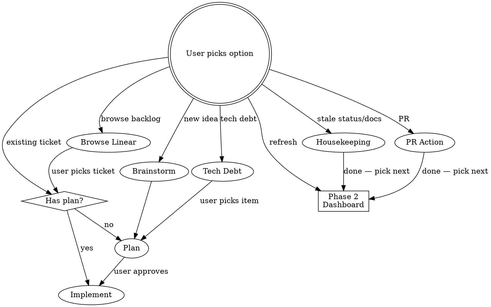

# Do Some Work

Developer workflow: find work, plan it, implement it, ship it. Uses Linear (tickets) and GitHub (`gh`, plain git branches).

## Phase 1: Gather Context

Fetch all data in 3 waves, maximising parallelism within each wave.

### Wave 1 — all parallel, zero dependencies

Fire all of these in a single message:

1. `list_issues(assignee: "me", state: "started")` — Linear MCP
2. `list_issues(assignee: "me", state: "unstarted")` — Linear MCP
3. `list_teams` — Linear MCP
4. `gh repo view --json nameWithOwner,defaultBranchRef` — repo slug (`<owner>/<repo>`) and default branch (`<base>`)
5. **Single GitHub GraphQL query** — all my open PRs (reviews, CI, comments, sizes, branch names) AND all PRs where my review is requested:
   ```bash
   gh api graphql -f query='{
     myPRs: viewer {
       pullRequests(first: 20, states: OPEN, orderBy: {field: UPDATED_AT, direction: DESC}) {
         nodes {
           number title isDraft reviewDecision additions deletions
           headRefName state url updatedAt
           reviews(last: 10) { nodes { state author { login } body submittedAt } }
           comments(last: 5) { totalCount }
           commits(last: 1) { nodes { commit { statusCheckRollup { state } } } }
         }
       }
     }
     reviewRequested: search(query: "is:pr is:open review-requested:@me", type: ISSUE, first: 20) {
       nodes { ... on PullRequest {
         number title url updatedAt additions deletions
         author { login } headRefName repository { nameWithOwner }
       }}
     }
   }'
   ```
   To scope review requests to one repo, add `repo:<owner>/<repo>` to the search query.

### Wave 2 — parallel, depends on Wave 1

1. `list_cycles(teamId, type: "current")` — one per team
2. `list_documents(query: "<TICKET-ID>")` — one per ticket (has-document / no-document)

### Wave 3 — parallel, depends on Wave 2

For each ticket with a document: `get_document(id)` — plan checkboxes, manual steps, blockers, progress.

### After Wave 3 — categorise

**Tickets:**
- **Housekeeping needed** — ticket status doesn't match PR state (PR merged but ticket still "In Review"/"In Progress"), or the work document shows stale progress. Quick wins via API calls.
- **Ready to implement** — has a work document with a plan, not blocked
- **Needs planning** — no work document, or no plan in it yet
- **Blocked** — blocking relations, or unresolved items in the document's "Blockers"

**My PRs:** awaiting review · changes requested · comments to address · approved.

**Others' PRs:** review requested.

**Staleness** — flag (1) ticket status vs PR state mismatches, and (2) document vs reality mismatches (e.g. branch has commits but the document shows no progress) so the user can confirm what's done.

**Manual steps** — scan each ticket for steps Claude can't do: anything in a CMS, cloud console, hosting dashboard, DNS, env vars, deploys, infrastructure, permissions, credentials, or third-party config. When writing these to the work document, include detailed numbered sub-steps (research what's needed first). If the document already has "Manual Steps", read its checkbox state: show `🔧 Manual steps` only when items are unchecked, `✔ Manual done` when all are checked.

**TL;DRs** — one line per dashboard row from data already fetched (reviews + CI for my PRs; size + title for others' PRs; linked PR status + document progress for tickets).

**Link PRs to tickets** — branch names contain the ticket ID (e.g. `eng-251-add-search` → `ENG-251`).

## Phase 2: Dashboard & Recommendations

### 2a: Display Dashboard

Print the dashboard as markdown — **not in a code block** (code blocks render with a grey background). Use markdown links for PR numbers and ticket IDs, bold section headers, and `---` rules.

**Links:**
- PRs: `[#123](https://github.com/<owner>/<repo>/pull/123)` (or the PR's `url` field)
- Tickets: the issue's `url` field from Linear

**Example:**

---

**Here's your dashboard**

**▸ YOUR PRs**

[#123] Add search flag · Draft · [ENG-251] · ⏳ Awaiting review
↳ *Submitted yesterday, no reviewers assigned yet*

[#118] Fix auth redirect · Changes req. · [ENG-260] · ⚠️ Address comments
↳ *@bob requested changes — 3 comments on redirect logic*

**▸ PRs WAITING FOR YOUR REVIEW**

[#130] Add auth middleware · @alice · ⏳ 2 days waiting
↳ *142 lines — adds JWT middleware to API routes*

**▸ YOUR TICKETS** (current cycle)

[ENG-260] Migrate discussion component · In Progress · High · Plan · → [#118]
↳ *API layer done, UI PR has changes requested*

[ENG-258] Add search · Todo · Normal · No plan
↳ *Not started — needs investigation and planning*

[ENG-262] Update hero banner · Todo · Normal · No plan · 🔧 Manual steps
↳ *Requires a CMS change: update the hero image field*

---

| ⚡ NEEDS YOU | 🤖 CLAUDE CAN ACTION |
|---|---|
| 1. [#130] — @alice waiting 2 days | 1. [ENG-258] — Investigate & plan |
| 2. [ENG-260] — Blocked on design | 2. [#118] — Address 3 comments |

---

### 2b: Recommendations

**⚡ Needs you** — only the human can unblock: PR reviews, approval decisions, design questions, externally blocked tickets, pending `🔧` manual steps. Sorted by how long others have been waiting.

**🤖 Claude can action** — sorted by priority:
1. **Housekeeping** — stale ticket statuses and work documents
2. **Addressing review comments** on my PRs
3. **Ready to implement** — tickets with approved plans
4. **Investigation/planning** — tickets needing plans

If Claude can do it via API calls or code changes without human judgment, it belongs in the right-hand column.

### 2c: Pick Next Action

Use `AskUserQuestion` with options drawn from the recommendations — top "Claude can action" items (housekeeping first), top "Needs you" items, plus:
- "Browse Linear for available work"
- "Brainstorm something new"
- "Find tech debt to reduce" (offer this especially when there's nothing else to do)
- "Refresh dashboard"

If there's nothing at all, skip the tables and say "All clear!" before asking.

## Phase 3: Route



### Route A: PR Action (review or respond)

1. `gh pr view <number> --json title,body,author,reviews,comments,reviewRequests,statusCheckRollup,additions,deletions,headRefName`
2. **Load review context** — `gh api repos/<owner>/<repo>/pulls/<number>/comments` and `.../reviews`, plus the linked work document's "Review Notes". Build a list of already-discussed issues (dismissed, corrected, or acknowledged as non-blocking). Never re-flag them; pass the list explicitly to any reviewer subagent.
3. **Review requested on someone else's PR:**
   - Note CI status and size; if >500 lines, summarise by file
   - Read `gh pr diff <number>` and present findings, starting with header links:
     ```
     **Review: <PR title>**
     PR: [#123](<PR url>) · Ticket: [ENG-226](<ticket url>)
     ```
   - Ask: "Approve, request changes, comment, or don't post?" Only post (`gh pr review <number> --approve|--request-changes|--comment`) on the user's explicit choice — nothing goes to the PR without it.
4. **Changes requested / comments on my PR:**
   - Show the comments with header links and summarise what's being asked
   - Ask: "Want me to address these?" If yes → `gh pr checkout <number>`, implement, commit with explicit staging, `git push`
   - **Reply on each addressed human thread** (`gh api repos/<owner>/<repo>/pulls/<number>/comments/<id>/replies -f body="..."`). A single PR summary doesn't replace these. Don't resolve threads — the reviewer owns resolution.
   - **Bot comments** (author login ends in `[bot]`) can be wrong — verify each against the code before implementing; reply with the reason on invalid ones; ask the user about uncertain ones.
   - Offer re-review only for reviewers whose state is `CHANGES_REQUESTED` or `COMMENTED`. **Never request re-review when the PR already has any human approval.**
5. **Persist review notes** to the linked work document's "Review Notes":
   ```
   ### Review N (date)
   - Issues raised: [list]
   - Resolved: [list]
   - Outstanding: [list]
   ```
6. Return to Phase 2.

### Route B: Brainstorm (new idea)

1. User describes what they need
2. Search Linear for existing tickets: `list_issues(query: "<description>")`; if one matches, ask whether to use it
3. Otherwise brainstorm and create a ticket with a **TL;DR**, an **Approaches considered** table (`| Approach | Description | Verdict |`), and a **Tasks** checklist
4. Create the **work document** (see "Work Document")
5. **STOP** — ask: "Approve plan and implement now, or pick another task?" Implement → Phase 4; otherwise → Phase 2.

### Route C: Plan (ticket exists, no plan)

1. Read the ticket thoroughly
2. Research the codebase — affected files, existing patterns
3. Write the plan with specific file paths and changes; every data-flow step stated end-to-end
4. If the work is large, ask whether the user wants it split into separate PRs (each branched from `<base>` and independently mergeable); default is one PR
5. Create or update the **work document**
6. **STOP** — ask: "Approve plan and implement now, or pick another task?" Implement → Phase 4; otherwise → Phase 2.

### Route D: Implement (ticket has plan)

→ Phase 4

### Route E: Tech Debt

1. Search for debt signals: `TODO`/`FIXME`/`HACK`/`XXX` comments (Grep tool), outdated dependencies (the repo's package manager), and Linear issues labelled tech-debt/chore
2. Present findings by category and ask the user to pick one
3. Existing ticket → Route C or D; no ticket → create one (as Route B step 3), then Route C

### Route F: Browse Linear

1. Unassigned tickets in current cycles: `list_issues(state: "unstarted", cycle: "<cycle-id>")` per team, filtered to no assignee
2. Unassigned backlog candidates: `list_issues(state: "backlog", limit: 20)`
3. Present by team, sorted by priority (ID, title, priority, labels, one-line TL;DR); highlight ones that match recent work
4. On pick → `save_issue(id, assignee: "me")`, then Route C or D

### Route G: Housekeeping

Execute immediately without confirmation:
1. **Stale ticket statuses** — PR merged → `save_issue(id, state: "done")`; PR closed unmerged → ask the user (might be intentional)
2. **Stale work documents** — update "Progress" and check off completed steps
3. **Merged branches** — list local branches whose PRs merged so the user can delete them
4. Return to Phase 2

### Route H: Refresh Dashboard

Re-run Phase 1 from scratch and re-render Phase 2.

## Work Document (source of truth)

Every ticket needs a Linear document linked to the issue — the single editable source of truth for plan, progress, blockers, and review notes. Create with `create_document`, update in place with `update_document`.

For the template and update rules, read `.claude/skills/_shared/work-document-template.md` (shared with the headless skill).

## Phase 4: Pre-Implementation Checks

All must pass before writing code:

1. **Work document exists** — `list_documents(query: "<TICKET-ID>")`; if none, create one now. Hard gate.
2. Show the plan summary + affected files and ask: "Proceed with implementation?"
3. **Existing branch?** — `gh pr list --state open --search "<ticket-id>"` and `git branch -a --list "*<ticket-id-lowercase>*"`.
   - If found, ask: "Continue existing work or start fresh?"
   - Continue → check it out (in the worktree, see Rules), diff against `origin/<base>`, compare with the plan, confirm with the user which steps are done, update the document, resume from the next unchecked step
4. **Dependencies?** — Linear "blocked by" relations, "depends on" / "after X lands" in the ticket, or plan references to code not yet on `<base>`. If found, ask: "Wait for PR #NNN to merge, or branch from it?"
5. `git fetch origin`

## Phase 5: Implementation

Update the Linear ticket → "In Progress": `save_issue(id, state: "started")`

### Branch setup — commit early, save often

Create the branch and an initial commit **before writing code**, so a dead session doesn't lose work:

```bash
git worktree add .worktrees/<ticket-id>-<short-slug> -b <ticket-id>-<short-slug> origin/<base>
```

Branch names are lowercase: `<ticket-id>-<short-slug>` (e.g. `eng-123-add-search`).

### Execute plan

- Follow the plan steps exactly; track progress with TodoWrite
- **Commit after each logical chunk** — stage only the files you changed, by name (`git add <paths>`, never `-A`/`.`/`--all`), then `git commit -m "..."`
- **Update the work document BEFORE every commit — hard gate.** Check off completed steps and update "Progress".
- **Match the codebase's comment density** — follow the pattern of the area you touch; no comments that justify the change to a reviewer or narrate its history

### Guardrails — STOP if:

- **Scope exceeded**: >10 files or >200 lines → confirm with the user
- **Tests fail after 2 fix attempts** → stop and report
- **Plan doesn't make sense** → stop, explain, ask
- **Merge conflicts** → stop, don't auto-resolve

When stopped, write the blocker to the work document's "Blockers" section.

When the work is a bug fix, don't ship a speculative fix — confirm the cause first (reproduce it, or trace the full chain through existing code). If you can't, present the leading candidate(s) and the check that would decide between them, and ask.

### Sensitive files — NEVER stage

`.env`, `.env.*`, `.credentials/`, `*.key`, `*.pem`, `*.secret`, `credentials.json`, service-account keys.

### Quality gates — ALL must pass

- [ ] Tests pass
- [ ] Lint passes (pre-existing warnings OK)
- [ ] Snapshots updated if needed
- [ ] No sensitive files staged

## Phase 6: Submission

1. Show the diff summary + test results
2. Ask: "Push and open a draft PR?"
3. On approval:
   ```bash
   git fetch origin
   git rebase origin/<base>       # only if behind; merge instead if the branch was already pushed
   git push -u origin <branch>
   gh pr create --draft --base <base> --head <branch> --title "<TICKET-ID>: <title>" --body "<body>"
   ```
   Body: summary, changes, test plan, Linear ticket link.
4. **Self-review** — read the full diff as a reviewer would. Fix anything wrong. Note non-obvious decisions (why, not what) in the PR description, or as inline comments on your own PR where they genuinely help a reviewer; skip trivial changes.
5. **Update the work document** — all completed steps checked, "Progress" shows branch, PR number, "Submitted"
6. Update the Linear ticket → "In Review"
7. Tell the user the PR is ready with its link, and remind them of any unchecked manual steps

## Rules

- **Stage only files you changed** — by name. Never commit plugin/agent files (`.agents/`, `AGENTS.md`, `.claude/skills/`) or unrelated workspace debris.
- **Never force-push** unless the user explicitly says so.
- **Never use `git stash`** — commit work-in-progress instead.
- **Draft PRs** — open as draft; the user marks ready.
- **Never work on `<base>`** — always branch first.
- **Confirm before final submission** — WIP commits during implementation are fine without asking; pushing and opening the PR needs a yes.
- **Only my tickets and my branches** — never modify tickets assigned to others or push to others' branches.
- **Work document required before implementation** — hard gate for every ticket. Use documents, not comments.
- **Document before commit** — always update the work document first.
- **Ticket format** — TL;DR, approaches table, task checklist.
- **Current cycle preferred** — prioritise tickets in the active cycle.
- **Ask instead of guessing** — if an instruction could refer to a different PR, ticket, or action, ask.
- **Never re-flag dismissed issues** — read prior reviews and the work document's "Review Notes" first.
- **Never post to someone else's PR without an explicit choice** from the user in this session.
- **Never request re-review when the PR already has a human approval** — it dismisses the approval.
- **Use a worktree for code changes** — other sessions may share the main checkout. Do all implementation and PR-fix work under `.worktrees/<name>/`; never switch branches or edit files in the main checkout. Remove the worktree (`git worktree remove`) when the PR is pushed.
