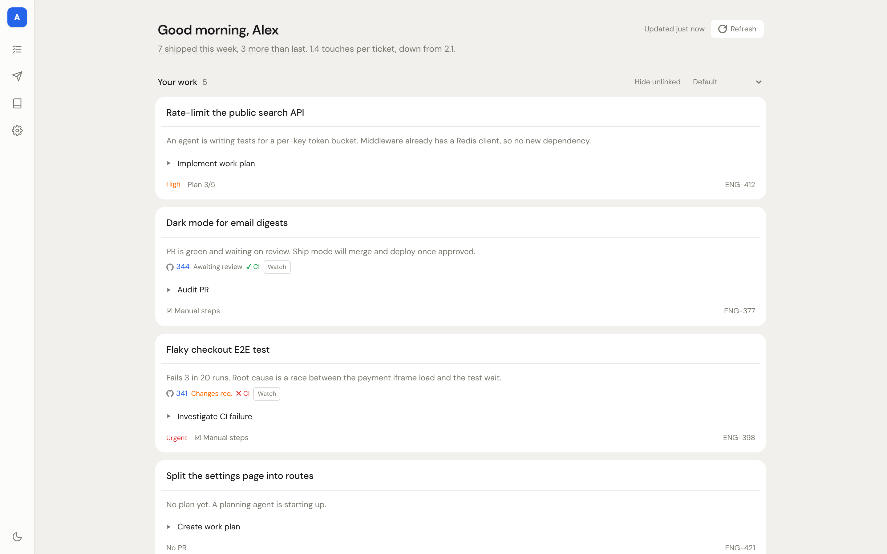

# Agent Dashboard



A web dashboard for dispatching and managing parallel headless Claude Code sessions. Each task runs in an isolated Docker container with full repo access, communicating back to the dashboard via an in-process supervisor (Agent SDK) with MCP-style tools for human-in-the-loop feedback.

## Architecture

```
┌─────────────────────┐
│   Next.js Dashboard  │  ← dispatch tasks, answer questions, view diffs
│   (SQLite + Drizzle) │
└────────┬────────────┘
         │  HTTP (DASHBOARD_URL)
         │
    ┌────┴────┐  ┌────┴────┐  ┌────┴────┐
    │ Docker  │  │ Docker  │  │ Docker  │   ← isolated agent containers
    │ Agent 1 │  │ Agent 2 │  │ Agent 3 │
    └─────────┘  └─────────┘  └─────────┘
    Each container runs:
    - Claude Code (headless, via the Agent SDK)
    - Supervisor with in-process tools (reply, say, post_diff, post_status, save_memory)
```

**Data flows one direction:** containers always call the dashboard — the dashboard never calls into containers.

## Components

### `/dashboard` — Next.js web app

The control plane. Manages tasks, orchestrates Docker containers, and provides the UI.

- **Task dispatch** — write a prompt or use quick actions (Implement, Review, Plan, Housekeeping, Brainstorm, General, Ship it)
- **AI Briefing** — AI-generated summary with one-click action buttons
- **Message thread** — real-time question/answer feed with each agent
- **Diff viewer** — review completed work before merging
- **Log viewer** — live container output via SSE
- **Docker orchestration** — starts/stops containers via `dockerode`
- **Background reconciler** — checks container health every 10s, auto-retries failed tasks
- **SQLite database** — tasks, messages, and diffs (Drizzle ORM)

### `/docker/supervisor` — Agent SDK runner (runs inside containers)

Owns the Claude Code session, in-process MCP tools, log forwarding, and final status posting. Exposes:

| Tool | Purpose |
|------|---------|
| `reply` | Post a question to the dashboard; polls for an answer, then safely suspends the task if none arrives in time (resumes when answered) |
| `say` | Post a non-blocking note to the dashboard thread (no answer expected) |
| `post_diff` | Send completed diffs back to the dashboard |
| `post_status` | Update task status (running, waiting, complete) |
| `save_memory` | Persist a learning/memory back to the dashboard for reuse on future tasks |

### `/docker` — Container image

Built on Node 24 with Claude Code, pnpm (via corepack), and GitHub CLI pre-installed. The entrypoint clones the repo, installs skills, and starts Claude Code in headless mode.

**Runtime env vars:**

| Variable | Required | Description |
|----------|----------|-------------|
| `CLAUDE_CODE_OAUTH_TOKEN` | Yes | Long-lived OAuth token from `claude setup-token` |
| `GITHUB_TOKEN` | Yes | GitHub PAT with repo scope |
| `REPO_URL` | Yes | GitHub repo in `owner/repo` format |
| `TASK_ID` | Yes | UUID for this task |
| `DASHBOARD_URL` | Yes | Dashboard URL for container callbacks |
| `AGENT_PROMPT` | Yes | The full prompt for Claude Code |
| `MODE` | No | Primary tag for logging |
| `TICKET_ID` | No | Linear ticket ID |
| `PR_NUMBER` | No | GitHub PR number |
| `LINEAR_API_KEY` | No | Linear API key for MCP server |
| `FIGMA_API_KEY` | No | Figma personal access token for MCP server |

### `/.claude/skills` — Agent skills

Skills are mounted into containers at runtime via Docker bind mount. Edit a skill file and the next task dispatch uses the updated version — no Docker image rebuild needed.

## Task Model

Tasks are generic — every task is a **prompt** + optional **tags** + optional **context**:

```json
{
  "prompt": "Run the do-some-work-headless skill in code mode for ticket ENG-123.",
  "tags": ["code"],
  "context": { "ticketId": "ENG-123" }
}
```

There is no mode enum. Quick actions (Implement, Review, Plan, Housekeeping, Brainstorm, General, Ship it) are UI shortcuts defined in `dashboard/src/lib/quick-actions.ts` that pre-fill prompts. To add a new task type, add an entry to `DISPATCH_MODES` (and optionally `DRAWER_PRESETS` for contextual presets) — no other files need changing.

## Integrations

All integrations are optional. The dashboard works with any combination:

| Integration | Env vars needed | What it provides |
|-------------|----------------|------------------|
| **GitHub** | `GITHUB_TOKEN`, `GITHUB_USERNAME` | PR data, reviews, CI status |
| **Linear** | `LINEAR_API_KEY`, `LINEAR_ORG_SLUG` | Tickets, cycles, work documents |

## Getting Started

### Prerequisites

- Docker Desktop running
- Node.js 20+
- pnpm
- A Claude Code OAuth token (`claude setup-token`)
- GitHub PAT with repo scope

### Configure environment

```bash
cp .env.example .env.local
# Edit .env.local with your tokens — see .env.example for descriptions
```

Required vars: `DASHBOARD_URL`, `CLAUDE_CODE_OAUTH_TOKEN`, `GITHUB_TOKEN`, `GITHUB_USERNAME`, `ANTHROPIC_API_KEY`, `REPO_URL`.

### Run the dashboard

```bash
pnpm --dir dashboard install
pnpm --dir dashboard dev    # http://localhost:3001
```

**Running without dev mode:** `pnpm start` from the repo root builds and runs the production server, which is noticeably snappier than dev mode.

The SQLite database is created automatically on first run and is preserved across updates — it holds task history, agent logs, diffs, and repo memories that are reused by future runs.

To apply schema changes without losing data, use one of:

- **Inline migration** — add an idempotent `ALTER TABLE` / `CREATE TABLE IF NOT EXISTS` statement to the `migrations` array in [`dashboard/src/lib/db.ts`](dashboard/src/lib/db.ts). It runs automatically on next startup and safely no-ops if already applied.
- **Drizzle Kit** — run `pnpm --dir dashboard db:push` to sync the live DB with `schema.ts`, or `pnpm --dir dashboard db:studio` to inspect it.

Only delete `dashboard/data/dashboard.db` as a last resort — you will lose all task logs and extracted memories.

### Build the agent image

```bash
docker build -f docker/Dockerfile -t agent-worker:local .
```

Rebuild with `--no-cache` after changing files baked into the image:
- `docker/entrypoint.sh`
- `docker/supervisor/` (src/, package.json, tsconfig.json)

Files mounted at runtime do **not** need a rebuild: skills (`.claude/skills/`), `docker/.claude/CLAUDE.md`, and `~/.claude/.claude.json`.

## Self-Healing

- **Background reconciler** checks container health every 10s and auto-retries failed tasks (configurable via `max_retries` in DB)
- **Resilient fetch** retries external API calls (GitHub, Linear) with exponential backoff
- **Supervisor** `reply` waits up to `REPLY_GRACE_WINDOW_MS` (default 10 min) for an answer, then safely suspends the task — it resumes when the human answers; dashboard HTTP calls are retried (3 attempts, 5xx only)
- **Manual retry** button on failed tasks in the UI

## Tech Stack

- **Dashboard:** Next.js 15, React 19, Tailwind CSS 4, Drizzle ORM, SQLite, dockerode
- **Supervisor:** Claude Agent SDK (`@anthropic-ai/claude-agent-sdk`), TypeScript
- **Containers:** Node 24, Claude Code, pnpm, GitHub CLI

## License

MIT — see [LICENSE](LICENSE).
